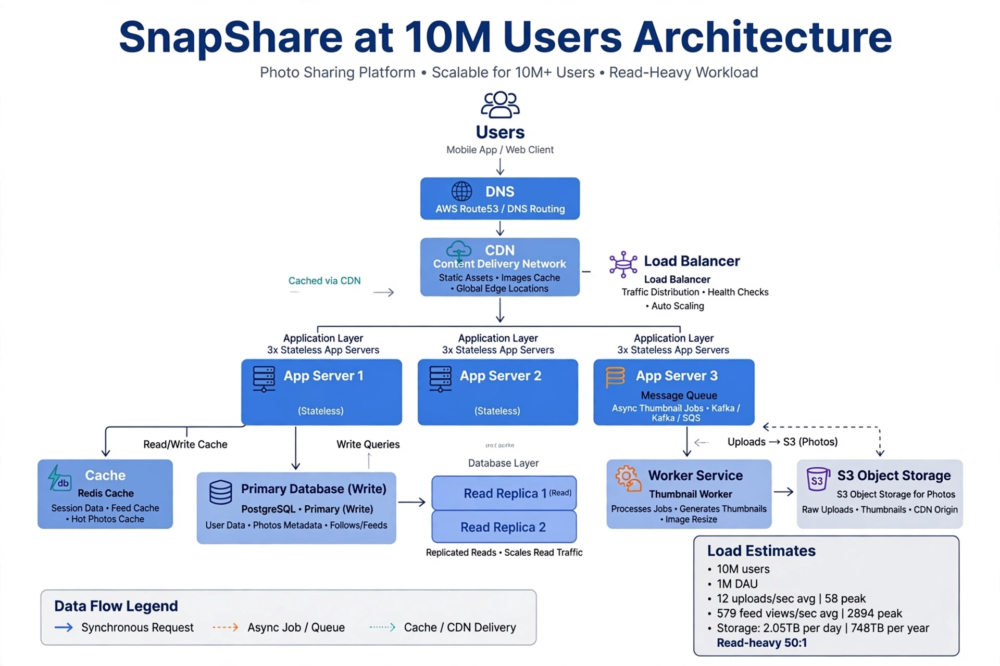

# Photo App Scaling to 1M DAU

## Requirements
- Functional: Upload photo, view feed, like, comment, follow
- Non-Functional: 1M DAU, 50:1 read-to-write ratio, Availability 99.9%
- Performance: p95 feed <200ms, p95 upload <500ms
- Durability: No photo loss, 11 9s durability

## Capacity Planning - 1M DAU
- DAU: 1,000,000
- Avg uploads per user per day: 1 photo
- Total uploads per day: 1,000,000 * 1 = 1,000,000 photos/day
- Uploads per second: 1,000,000 / 86400 = 11.6 RPS avg, peak 5x = 58 RPS writes
- Feed views: 50 views per user per day = 50,000,000 views/day
- Feed RPS: 50M / 86400 = 578.7 ~ 579 RPS avg, peak 5x = 2895 RPS reads
- Read-to-write ratio: 50:1 (50 reads per 1 write)
- Avg photo size: 2MB original + 200KB thumbnail
- Storage per day: 1M * 2MB = 2 TB/day raw
- Storage per year: 2 TB * 365 = 730 TB + thumbnails 73 TB = ~748 TB per year (as noted in feedback)
- DB metadata per photo: ~500 bytes * 1M/day = 500MB/day ~182GB/year manageable
- Conclusion: Cannot store binary blobs in relational DB - would cause replica lag and connection depletion. Must use object storage S3 for photos, DB only for metadata (user_id, s3_url, thumbnail_url, created_at).

## Architecture Diagram - Complete

Flow: Client -> DNS -> CDN -> Load Balancer -> App Servers -> Cache + Object Storage + Primary DB -> Read Replica + Queue Worker. Includes all: CDN, load balancer, app servers, cache, database replica, object storage, async worker queue.

## Component Roles - One Sentence Each
- Client: Mobile/browser app that uploads photos via presigned S3 URL and displays feed with cached thumbnails.
- DNS Route53: Resolves domain to CDN/LB IP and fails over across regions.
- CDN CloudFront: Serves thumbnails and feed images from edge within 20ms, offloads 80% of 579 RPS reads from origin.
- Load Balancer ALB: Distributes upload/feed traffic to healthy app servers, terminates SSL, avoids single server overload.
- App Server: Stateless API handling auth, generates S3 presigned URLs, writes photo metadata to primary DB, enqueues thumbnail jobs.
- Cache Redis: Stores hot feed pages key feed:user:{id} with 60s TTL and user timelines to serve 50:1 reads without hitting DB.
- Primary DB Postgres: Stores photo metadata only (id, user_id, s3_url, thumbnail_url, caption, created_at) not binary blobs for ACID consistency.
- Read Replica: Serves 80% of feed SELECT queries, offloads primary, scales reads horizontally for 2895 peak RPS.
- Object Storage S3: Durable 99.999999999% storage for 748 TB/year of original photos and thumbnails, avoids DB bloat and replica lag.
- Queue SQS + Thumbnail Worker: Decouples slow image resizing from upload request, worker pulls job, creates 200KB thumbnail via Sharp, uploads to S3, updates DB.

## Step-by-Step Upload Flow with Background Thumbnail
1. User selects photo in app, app calls POST /api/v1/photos/presign to get presigned S3 URL
2. App server authenticates JWT, validates quota, generates presigned URL for bucket quicknotes-photos/{userId}/{uuid}.jpg expiring in 5 mins
3. App returns presigned URL to client (200ms)
4. Client uploads 2MB photo directly to S3 via PUT presigned URL, bypassing app servers to handle 58 RPS peak writes efficiently
5. S3 upload success triggers client to call POST /api/v1/photos with {s3_key, user_id, caption}
6. App server validates, INSERT INTO photos (user_id, s3_url, status='processing', created_at) into Primary DB
7. App server invalidates cache DEL feed:*
8. App server enqueues message to SQS: {type:'thumbnail', photo_id, s3_key, sizes:[200x200,400x400]}
9. App server returns 201 Created immediately {photo_id, status:'processing'} so upload feels fast <500ms p95
10. Thumbnail Worker (separate auto-scaled service) polls SQS, downloads original from S3
11. Worker generates thumbnails using Sharp, uploads thumbnails to S3 bucket quicknotes-thumbs/{photo_id}_200.jpg
12. Worker updates Primary DB: UPDATE photos SET thumbnail_url='s3://...', status='ready' WHERE id=...
13. Worker deletes job from SQS ACK. If fails, job retries with backoff.
14. Feed request later hits CDN, CDN miss -> ALB -> App Server -> Read Replica SELECT metadata -> returns thumbnail_url from S3 via CDN.

## Feed View Flow (Read Path 50:1 ratio)
1. User opens feed -> GET /feed?limit=20 with JWT
2. DNS -> CDN checks edge cache for feed:user:123, hit 80% -> return in 20ms
3. CDN miss -> ALB -> App Server 1
4. App checks Redis GET feed:user:123:limit20, hit -> return
5. Redis miss -> Read Replica query: SELECT id, thumbnail_url, caption FROM photos ORDER BY created_at DESC LIMIT 20
6. App writes to Redis SETEX 60s and returns to CDN, CDN caches.

## Trade-off Analysis - 2 Trade-offs
1. Object Storage S3 vs Storing Blobs in Postgres: Chose S3 because 748 TB/year binary would cause massive replication lag, deplete DB connections, bloat WAL logs, make backups impossible. S3 gives 11 9s durability and cheap storage. Trade-off: eventual consistency for metadata vs blob - photo may be in S3 but DB not yet updated for 100ms, need read-your-writes logic. Alternative DB blob would give strong consistency but fails at scale, as you correctly identified connection depletion.

2. Async Thumbnail via Queue vs Synchronous Resize in Request: Chose async SQS + Worker because resizing 2MB to 200KB takes 500-800ms CPU heavy, would make POST >1s and block app server threads under 58 RPS peak. Queue makes upload return 201 in <500ms p95 and scales workers independently. Trade-off: User sees 'processing' state for 1-2 seconds before thumbnail ready, feed may show placeholder initially. Acceptable for photo app vs slow uploads.

3. Cache-Aside with CDN + Redis vs Write-Through: Cache-aside lazy loads only hot feeds, simple, saves memory for 1M DAU with 50:1 reads. Cons: first miss slower. Write-through keeps cache always fresh but doubles writes.

## SPOF Avoidance
- App Servers: 3+ across 2 AZs behind ALB, health check every 10s, if one dies ALB stops routing.
- ALB: Managed multi-AZ service, not single EC2.
- Primary DB: RDS Multi-AZ with auto-failover 60s, daily snapshots to S3, PITR enabled.
- Read Replica: 2 replicas, if one fails other serves 579 RPS reads.
- Redis: Cluster with replica and Sentinel failover, app fallback to DB if cache down.
- S3: 99.99% SLA multi-AZ by design, versioning enabled, cross-region replication.
- SQS Queue: Managed multi-AZ persistent, if worker dies job stays in queue and retries.
- CDN/DNS: CloudFront/Route53 global managed, no SPOF, edge locations worldwide.

## Conclusion
With CDN offloading 80% of 2895 peak feed RPS, Redis handling hot feeds, S3 storing 748 TB/year images, and async workers for thumbnails, system handles 1M DAU at 50:1 read ratio with p95 <200ms feed and <500ms upload.

